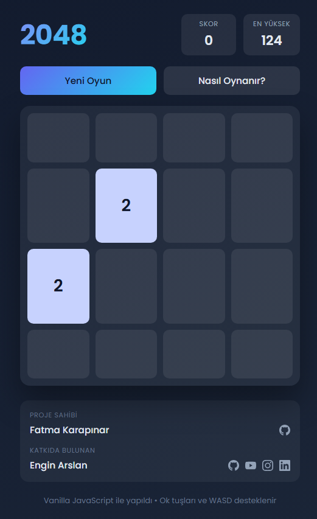

# 2048 - Oyun

<div align="center">



</div>

**2048**, HTML5, CSS3 ve Vanilla JavaScript (Saf JavaScript) kullanılarak geliştirilmiş, klasik sayı birleştirme oyunudur.

Proje, başlangıçta temel oyun mekanikleriyle hazırlanmış olup yapılan geliştirmelerle birlikte daha modern, kullanıcı dostu ve işlevsel bir hâle getirilmiştir.

Herhangi bir JavaScript framework'ü veya harici kütüphane kullanılmamıştır.

Bu çalışma; JavaScript ile oyun geliştirme, DOM manipülasyonu, değişken yönetimi, olay yönetimi (event handling) ve algoritma mantığını öğrenmek isteyenler için de örnek bir projedir.

---

## Oyun Hakkında

Oyunun amacı, aynı değere sahip sayıları birleştirerek daha büyük sayılar elde etmek ve **2048 sayısına ulaşmaktır.**

Oyun tahtası 4x4 olmak üzere toplam 16 hücreden oluşur. Sayılar, WASD veya yön tuşları kullanılarak hareket ettirilir. Aynı değere sahip iki sayı birleştiğinde değerleri toplanarak yeni bir hücre oluşturur.

---

## Özellikler

### Oyun Mekanikleri

- 4x4 oyun tahtası (16 hücre).
- WASD ve yön tuşlarıyla oyun kontrolü.
- Gerçek 2048 birleştirme algoritması.
- Yeni sayıların %90 ihtimalle 2, %10 ihtimalle 4 olarak oluşturulması.
- Anlık skor takibi.
- En yüksek skorun `localStorage` ile kalıcı olarak saklanması.
- Oyun bittiğinde **Oyun Bitti!** mesajının gösterilmesi.
- 2048 sayısına ulaşıldığında tebrik mesajının gösterilmesi.
- Oyun yeniden başlatıldığında tahtanın temizlenmesi.
- **Tekrar Dene** butonuyla yeni oyun başlatma.

### Arayüz ve Kullanıcı Deneyimi

- Modern ve profesyonel koyu tema.
- Kullanıcı dostu ve sade arayüz.
- Dikey ve yatay olarak ortalanmış modal pencere.
- Modal içerisinde **Nasıl Oynanır?** rehberi.
- Oyun rehberinin 15 saniye sonra otomatik kapanması.
- Modal dışındaki alana tıklayarak pencereyi kapatma.
- Farklı ekran boyutlarına uyum sağlayan responsive tasarım.
- Daha düzenli ve görsel açıdan geliştirilmiş skor alanları.
- Favicon desteği.
- Sayı değerlerine göre farklı hücre renkleri (2'den 8192'ye kadar).

### Kod Kalitesi

- Değişkenlerin düzenli ve doğru tanımlanması.
- Kodların açıklayıcı yorum satırlarıyla düzenlenmesi.
- Oyun yeniden başlatıldığında tahtanın doğru şekilde temizlenmesi.
- Daha okunabilir ve sürdürülebilir kod yapısı.
- Oyun mekanikleri ile arayüz etkileşimlerinin düzenlenmesi.

---

## Orijinal Sürüm ve Geliştirilmiş Sürüm Karşılaştırması

Projenin başlangıçtaki hâli ile yapılan geliştirmeler sonucunda ulaştığı sürüm arasındaki temel farklılıklar aşağıda gösterilmiştir.

| Özellik | Orijinal Sürüm | Geliştirilmiş Sürüm |
|---|---|---|
| Oyun tahtası | 4x4 | 4x4 |
| Klavye kontrolleri | Sadece WASD | WASD + Ok tuşları |
| 4 sayısının oluşması | Yok, sadece 2 | %10 ihtimalle var |
| Skor sistemi | Sayfa yenilenince sıfırlanıyor | Anlık skor takibi |
| En yüksek skor | Yok | localStorage ile kalıcı |
| Oyun sonu kontrolü | Yok | Var |
| 2048 kazanma kontrolü | Yok | Var |
| Tekrar oynama | Start Game butonu | Tekrar Dene butonu |
| Nasıl Oynanır? | Yok | Modal pencere |
| Modal otomatik kapanma | Yok | 15 saniye |
| Favicon | Yok | Var |
| Tasarım | Basit ve soft CSS | Modern koyu tema |
| Responsive tasarım | Temel | Geliştirilmiş |
| Hücre renkleri | 2'den 8192'ye kadar | Korundu |
| Kod düzeni | Bazı hatalar mevcut | Düzenlendi ve iyileştirildi |
| Proje sahibi ve katkılar | Belirtilmemiş | Credits bölümü eklendi |
| Sosyal medya bağlantıları | Yok | İkonlu bağlantılar eklendi |

---

## Oyun Kontrolleri

| Tuş | Hareket |
|:---:|:---|
| **W** / **↑** | Yukarı |
| **A** / **←** | Sola |
| **S** / **↓** | Aşağı |
| **D** / **→** | Sağa |

---

## Kurulum ve Çalıştırma

Projeyi bilgisayarınıza indirmek ve çalıştırmak için aşağıdaki adımları takip edebilirsiniz.

### 1. Repoyu klonlayın

Bilgisayarınızda terminal veya komut istemcisini açarak aşağıdaki komutu çalıştırın:

```bash
git clone https://github.com/EnginArslan49/2048Game.git
```

### 2. Proje klasörüne girin

```bash
cd 2048Game
```

### 3. Oyunu başlatın

Proje klasöründeki `index.html` dosyasını Google Chrome, Microsoft Edge, Firefox veya başka bir modern web tarayıcısıyla açın.

> **Not:** Oyun doğrudan tarayıcı üzerinden çalıştırılabilir.

---

## Kullanılan Teknolojiler

| Teknoloji | Kullanım Amacı |
|---|---|
| **HTML5** | Sayfa yapısı ve oyun bileşenleri |
| **CSS3** | Tasarım, animasyonlar ve responsive arayüz |
| **Vanilla JavaScript** | Oyun algoritması, DOM manipülasyonu ve etkileşim yönetimi |
| **localStorage** | En yüksek skorun tarayıcıda saklanması |

---

## Proje Sahibi

**Fatma Karapınar**

[](https://github.com/ftmkarpinar)

---

## Katkıda Bulunan

**Engin Arslan**

[](https://github.com/EnginArslan49)

[](https://www.youtube.com/@ramkafe)

[](https://www.instagram.com/49engn04)

[](https://www.linkedin.com/in/engin-arslan-49e04/)

---

## Lisans

Bu proje açık kaynak olarak paylaşılmıştır. Kullanabilir, inceleyebilir, geliştirebilir ve paylaşabilirsiniz.

**Not:** Proje, orijinal 2048 oyunundan esinlenilerek geliştirilmiştir.